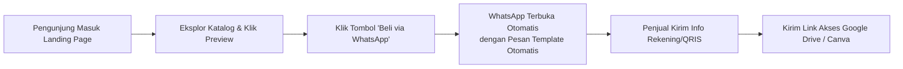

# 📋 Implementation Plan: Landing Page Penjualan Template Desain

> **Mata Kuliah:** Digital Entrepreneur / Kewirausahaan Digital  
> **Tema Desain:** *Clean, Modern, Minimalis, & Elegan (Editorial Design Studio)*  
> **Tech Stack:** React 18 + Vite + Tailwind CSS + Framer Motion + Lucide React  
> **Model Transaksi:** Direct Order via WhatsApp (Tanpa backend, database, atau payment gateway)

---

## 1. 🎯 Konsep Produk & Strategi Penjualan

### A. Value Proposition
* **Nama Brand/Layanan:** **karsa.co** (Digital Template Studio).
* **Produk yang Dijual:** Paket template siap pakai yang menyasar kebutuhan kreator konten, mahasiswa, dan UMKM:
  1. **Social Media & Feed Instagram Kit** (Canva & Figma).
  2. **Pitch Deck & Professional Presentation Slides** (Canva & PPT).
  3. **UMKM Starter Branding Kit** (Logo editable, brosur, banner promosi).
* **Solusi Utama:** Menghemat waktu pembuatan konten visual tanpa perlu skill desain tingkat lanjut.

### B. Alur Pemesanan (Zero Backend / Direct WhatsApp Flow)


---

## 2. 🎨 Desain Sistem & Estetika Visual (Mengikuti Referensi Portofolio)

* **Palet Warna:**
  * **Latar Belakang:** Pure Clean Canvas (`#FAFAFA` dan `#FFFFFF`).
  * **Teks & Kontras:** Deep Dark Zinc (`#09090B` & `#27272A`) untuk tipografi tegas dan elegan.
  * **Aksen Konversi (Subtle Luxury):** Amber/Gold halus (`#D97706` / `#F59E0B`) atau Emerald (`#059669`) khusus untuk badge diskon, pill rekomendasi, dan status harga.
* **Tipografi:**
  * *Heading:* `Plus Jakarta Sans` / `Outfit` (bersih, tegas, profesional).
  * *Body Text:* `Inter` (tingkat keterbacaan tinggi di berbagai ukuran layar).
* **Micro-Interactions & Feel:**
  * **Sticky Glassmorphic Header** dengan blur latar belakang halus.
  * **3D Tilt Preview Card** pada mockup template utama di Hero Section (menggunakan *Framer Motion Spring*).
  * **Animated Ticker / Marquee** yang menampilkan format file (*Canva*, *Figma*, *Photoshop*, *PowerPoint*).
  * **Modal Preview Interaktif** untuk melihat rincian isi paket tanpa me-refresh halaman.

---

## 3. 🏗️ Struktur Komponen Halaman (Versi Sederhana & Berfokus Katalog)

```
[ Sticky Glassmorphic Navbar ]
            │
[ 1. Hero Section (Headline, Dual CTA, Mockup Card Foto Editorial) ]
            │
[ 2. Running Ticker Marquee (Canva Ready, Figma Compatible, dsb.) ]
            │
[ 3. Katalog Template & Live Filter Kategori (Fokus Utama) ]
            │
[ 4. Modal Quick Preview (Detail Isi Paket & Akses WhatsApp) ]
            │
[ 5. Cara Membeli / How it Works (3 Langkah Cepat Direct Order) ]
            │
[ 6. Floating WhatsApp CTA & Minimalist Footer ]
```

---

## 4. 📑 Rincian Setiap Bagian (Section Breakdown)

### 1. Sticky Navbar
* **Brand Monogram & Name:** Contoh: `karsa.co` dengan badge kecil `DIGITAL TEMPLATES`.
* **Navigasi Cepat:** Keunggulan, Katalog, Paket Hemat, FAQ.
* **Tombol Aksi:** *"Pesan Sekarang"* yang langsung scroll ke katalog atau trigger WhatsApp.

### 2. Hero Section
* **Badge Status:** *"🔥 Promo Launching Diskon 60%"*.
* **Headline:** *"Bikin Desain Visual Kelas Profesional dalam Hitungan Menit."*
* **Subheadline:** *"Ratusan koleksi template siap pakai untuk Instagram, presentasi, dan branding bisnismu. Tinggal ganti teks dan gambar di Canva atau Figma."*
* **Dual Action:**
  * Tombol Utama: *"Lihat Katalog Template"* (Scroll halus).
  * Tombol Sekunder: *"Chat Admin / Tanya Dulu"* (Direct link WA).
* **Mockup Visual Interaktif:** Card 3D tilt yang memperlihatkan preview slide template desain dengan efek melayang dan badge *"Mudah Diedit di Canva"*.

### 3. Marquee Supported Tools
* Teks berjalan lembut (kanan-kiri): *Canva Ready • Figma UI Kit • Microsoft PowerPoint • Fully Editable • Commercial Use License • Instant Access*.

### 4. Value Proposition (Kenapa Memilih Template Ini?)
* Grid 3 atau 4 kartu bernuansa minimalis:
  1. **1-Click Edit di Canva/Figma:** Tidak butuh software berat atau skill desain pro.
  2. **Lisensi Komersial Bebas:** Boleh dipakai untuk branding klien atau jualan produk sendiri.
  3. **Hemat Puluhan Jam Kerja:** Fokus ke jualan dan konten, biar template kami yang mengurus visual.
  4. **Akses Seumur Hidup (Lifetime):** Sekali bayar, dapat update template berkala via cloud link.

### 5. Katalog Template & Filter Interaktif
* **Filter Tabs:** *Semua*, *Instagram & Sosmed*, *Pitch Deck / PPT*, *Branding UMKM*.
* **Item Card:**
  * Thumbnail mockup desain yang memikat.
  * Tag platform: `Canva`, `Figma`.
  * Info isi: misal `50+ Post Grid & Story`, `30+ Slides Premium`.
  * Harga coret & harga promo: `Rp 49.000` *(Normal Rp 129.000)*.
  * Tombol: *"Preview Isi"* & *"Beli via WA"*.

### 6. Modal Quick Preview
* Pop-up saat pembeli klik "Preview Isi" pada kartu katalog.
* Menampilkan ringkasan lembar slide / post, resolusi, format download, serta tombol checkout WhatsApp khusus produk tersebut.

### 7. Paket Promo Bundel (All-in-One)
* Kartu perbandingan / highlight khusus:
  * **Mega Bundle Creator & UMKM (Semua Akses):** Seluruh template Instagram + Slide + Branding digabung dengan potongan harga spesial (misal `Rp 99.000`).

### 8. Cara Beli (3 Langkah Mudah)
* Desain visual timeline ringkas:
  1. **Pilih Template:** Tentukan paket atau template satuan yang kamu butuhkan.
  2. **Konfirmasi WhatsApp:** Klik tombol beli, kirim format chat otomatis ke admin.
  3. **Akses Instan:** Selesaikan pembayaran via QRIS/Transfer, link Canva/Drive langsung dikirim ke WhatsApp kamu.

### 9. FAQ (Accordion)
* Pertanyaan umum yang meyakinkan pembeli:
  * *"Apakah pemula yang tidak bisa desain bisa menggunakannya?"*
  * *"Apakah harus punya akun Canva Pro?"* (Jawab: Bisa pakai akun Canva Gratis).
  * *"Bagaimana cara menerima filenya setelah bayar?"*

### 10. Footer & Floating CTA
* Footer rapi berisi copyright, identitas pembuat (kuliah/proyek), dan link media sosial.
* Floating WhatsApp Button di sudut kanan bawah untuk konsultasi cepat.

---

## 5. 🛠️ Rencana Eksekusi & Tahapan Pengerjaan

> [!NOTE]
> Pengerjaan dibagi menjadi 4 tahap utama agar struktur rapi, cepat selesai, dan mudah disesuaikan.

| Tahap | Fokus Pekerjaan | Output / Deliverable |
| :--- | :--- | :--- |
| **Tahap 1** | **Setup Proyek & Lingkungan** | Inisialisasi Vite + React, setup Tailwind CSS, konfigurasi Lucide React & Framer Motion. |
| **Tahap 2** | **Komponen Inti & Mock Data** | Membuat data produk template (`templatesData.js`), Navbar, Hero Section, dan Banner Marquee. |
| **Tahap 3** | **Katalog Produk & Interaktivitas** | Komponen Katalog dengan Filter kategori, Card produk, Modal Preview, dan Bundel Promo. |
| **Tahap 4** | **Value Props, FAQ, & WhatsApp Logic** | Pembuatan section Fitur, Cara Beli, Accordion FAQ, generator link WhatsApp otomatis, dan Footer. |

---

## 6. 📱 Format Otomasi Chat WhatsApp

Ketika pembeli mengklik tombol *"Beli Template Ini"*, sistem akan langsung membuka WhatsApp menuju nomor kamu dengan template pesan terisi otomatis:

```text
Halo Admin karsa.co,
Saya tertarik untuk membeli:
👉 Paket: [Nama Template/Bundel]
👉 Harga Promo: [Rp XX.000]

Mohon info rekening/QRIS untuk pembayarannya ya. Terima kasih!
```
Hal ini memastikan alur transaksi terasa cepat, profesional, dan ramah pembeli.
